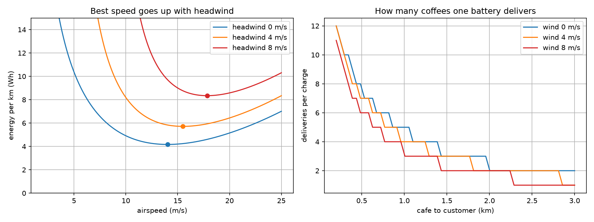
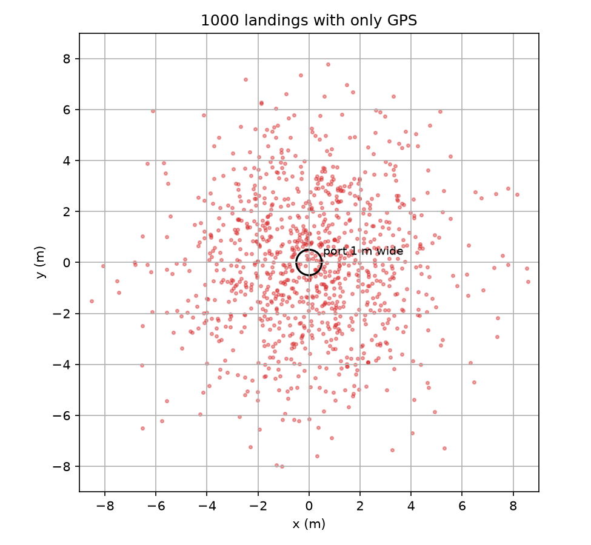
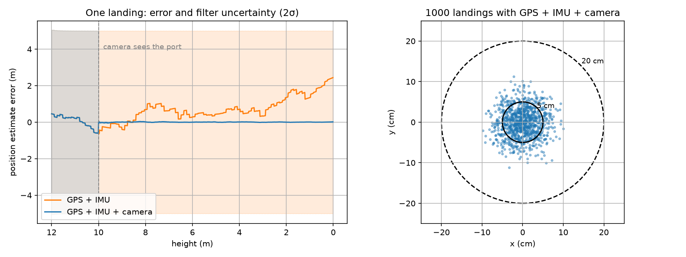
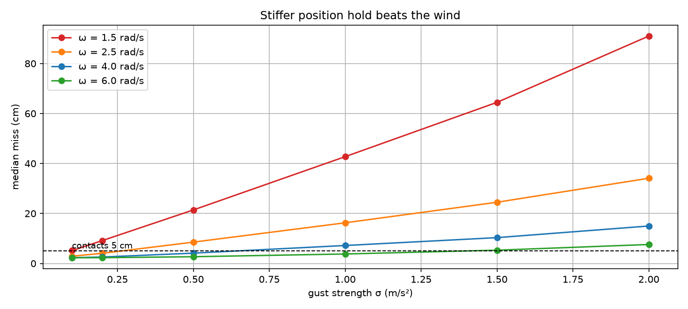
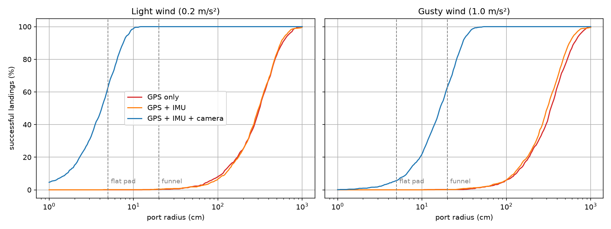

# coming home to charge – how a delivery drone lands on its port by itself

**the issue:** a delivery drone that charges by itself has to land on
its charging contacts, within a few centimeters. gps in a city is off
by meters because the signal bounces off buildings, and it doesn't
average out because it is a slow drift, not noise. i'm building mote,
a small quiet drone that brings you one coffee, and it has to fly back
to its port and charge with nobody around.

## my approach

1. model battery use from momentum theory and find when the drone has to go home
2. simulate 1000 landings on the port with gps only
3. build a kalman filter that fuses gps, imu and a camera looking at a marker on the port, with the gps bias as part of the state
4. test how wind gusts and controller stiffness change the landing
5. find how big the port has to be (flat pad vs funnel)

## outcomes

with gps only the drone misses the port by 3.1 m (median) and lands on
a 1 m port just 2% of the time. adding the imu barely helps, because the
problem is the bias, not the noise. with the camera the median miss
drops to 4.2 cm and all 1000 landings end within 20 cm in light wind.
in gusty wind what matters is how stiff the position hold is, not how
fast the drone descends. a funnel shaped port catches 100% of landings in
light wind, a flat pad with 5 cm contacts only 63%.

one battery does about 5 deliveries at 1 km in calm air and 3 in 8 m/s
wind, so the drone checks the wind before every delivery to decide if
it has to go home first.

## visual representations

### battery and deliveries per charge

### gps only

### kalman filter with camera

### wind and controller stiffness

### port size

## technology stack

- numpy, matplotlib
- methods applied: momentum theory, kalman filter with bias estimation, monte carlo simulation

the numbers (1.5 kg drone, 74 Wh battery, gps bias 2.5 m) are design
targets and typical values, not measurements yet.
